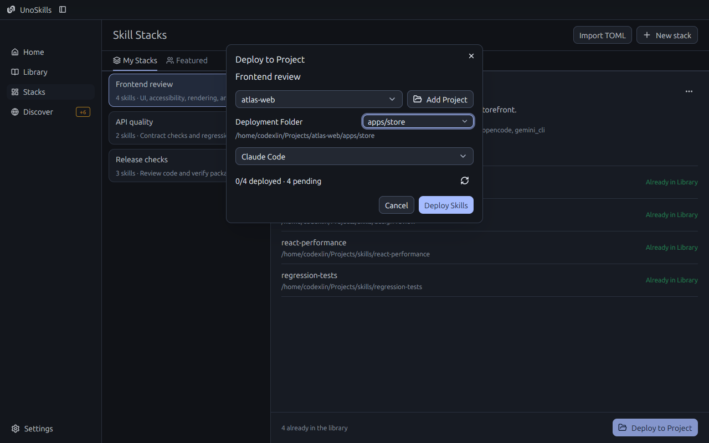
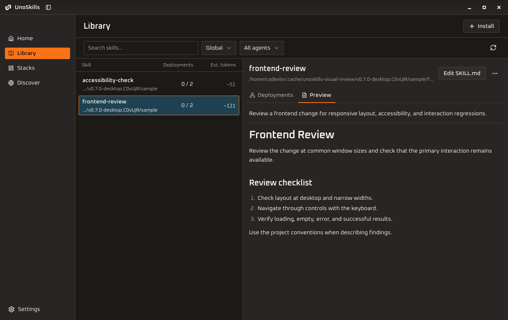
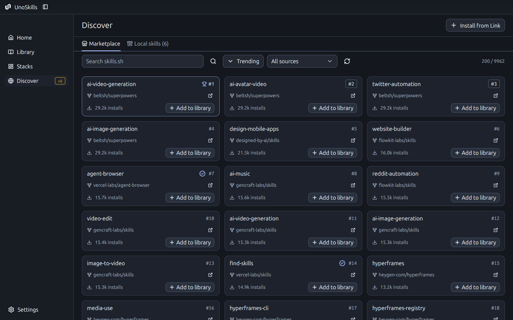

<p align="center">
  
</p>

<h1 align="center">UnoSkills</h1>

<p align="center">
  A native desktop workbench for AI agent skills.<br/>
  Keep one local library, build reusable stacks, and deploy them to the agents and projects you use.
</p>

<p align="center">
  <a href="https://github.com/codexlin/UnoSkills/releases/latest"></a>
  <a href="https://github.com/codexlin/UnoSkills/actions/workflows/ci.yml"></a>
  <a href="LICENSE"></a>
</p>

<p align="center">
  <a href="https://github.com/codexlin/UnoSkills/releases/latest"><strong>Download</strong></a> ·
  <a href="#quick-start">Quick start</a> ·
  <a href="#project-skills">Project skills</a> ·
  <a href="#desktop-screenshots">Screenshots</a> ·
  <a href="README.zh-CN.md">简体中文</a>
</p>


## Install

Download the installer for your platform from [GitHub Releases](https://github.com/codexlin/UnoSkills/releases/latest). Each release includes the desktop app, the `unoskills` CLI, and `SHA256SUMS.txt`.

| Platform | Installer |
| --- | --- |
| macOS (Apple Silicon) | Open `unoskills-macos-arm64.dmg` and drag UnoSkills to Applications. |
| Windows x64 | Run `unoskills-setup-<version>-windows-x64.exe`. |
| Debian and Ubuntu x64 | Run `sudo apt install ./unoskills_<version>_amd64.deb`. |

Portable archives are available on the same release page. macOS builds are currently ad-hoc signed.

## Quick start

1. **Add a skill.** In **Discover**, browse skills.sh or choose **Install from Link** to add a GitHub skill, an `owner/repo@skill` reference, or a local folder. **Local skills** lists skills already on your machine that you can bring under management.
2. **Deploy from your library.** Select a skill in **Library** and toggle deployment for the agents that need it. Symlink mode uses the central copy directly. Copy mode creates a local copy at the deployment destination.
3. **Save a reusable stack.** In **Stacks → My Stacks**, group skills into a named stack. Install its missing skills together, export the TOML, or share it with your team.

The library lives on your machine at `~/.unoskills`. Library management, local stacks, and TOML import and export work without an account.

## Project skills

Attach a project from **Home → Recent Projects**. Open it to see the technologies UnoSkills recognized and the configuration file behind each result. For a monorepo, choose a detected subproject under **Scan Scope** to get recommendations for that part of the codebase.


Select the skills you want and choose **Save as Stack**. If skills are missing from the library, install them and continue to the deployment preview. Choose an agent and the **Deployment Folder**. The preview defaults to the project root and also lets you choose a detected subproject. It shows the deployment counts before confirmation and preserves existing files when targets conflict.

<details>
<summary>See the deployment preview</summary>



</details>

## What you can do

| Area | What it does |
| --- | --- |
| **Home** | Open recent projects, jump to My Stacks, and see library activity and the skills.sh leaderboard. |
| **Library** | Preview or edit `SKILL.md`, check lint findings and token estimates, update skills, and manage per-agent deployments. |
| **Stacks** | Use featured or community stacks, create your own, and exchange portable TOML manifests. |
| **Discover** | Search the marketplace, filter loaded results by source, install from links, or add existing local skills to the library. |
| **Settings** | Choose system, light, or dark appearance, switch between English, 简体中文, and 日本語, and configure agents, network access, and Git backup. |

## Desktop screenshots

These screenshots show UnoSkills with a sample workspace.

<details>
<summary>Library and Stacks</summary>




</details>

<details>
<summary>Discover and Settings</summary>




</details>

## Supported agents

UnoSkills detects 22 built-in agents, including Claude Code, Codex, Cursor, Antigravity, OpenCode, Gemini CLI, and GitHub Copilot. See the [full agent registry](crates/unoskills-core/data/agents.toml). You can register a custom agent or override a built-in agent’s skills directory in **Settings**.

## CLI

The desktop app and CLI share the same library and SQLite database. Use `--json` when scripting.

```bash
unoskills install anthropics/skills@skill-creator
unoskills deploy skill-creator --agent claude_code --agent codex
unoskills project add ./my-app
unoskills project deploy skill-creator --project my-app --agent codex
unoskills stack install ./frontend-review.unoskills-stack.toml
unoskills list --json
```

## Development

Use the stable Rust toolchain. On Linux, install the system dependencies listed in the [CI workflow](.github/workflows/ci.yml).

```bash
cargo test --workspace --locked
cargo run -p unoskills-app --locked
cargo run -p unoskills-cli --locked -- agents
```

The workspace uses Native Shell (NSH) for the desktop app, a shared Rust core for the library and safe deployment, and a thin CLI.

- [Architecture](docs/ARCHITECTURE.md)
- [Skill stack format](docs/STACKS_SPEC.md)
- [Roadmap](docs/ROADMAP.md)
- [Contributing](CONTRIBUTING.md) and [engineering guidelines](AGENTS.md)

## Troubleshooting

- **macOS blocks the first launch.** Check **System Settings → Privacy & Security** for the option to allow the app to open.
- **The Linux window is blank or fails to open.** Check that a Vulkan-capable graphics driver is installed. An X11 session may also need `libxkbcommon-x11`.
- **An agent is missing.** Check its detection or path override in **Settings**. If you [open an issue](https://github.com/codexlin/UnoSkills/issues), include the relevant portion of `unoskills agents --json`.

## License

[MIT](LICENSE)
