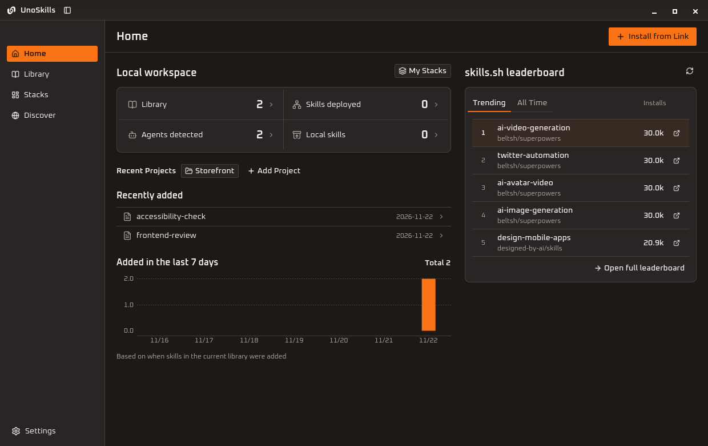
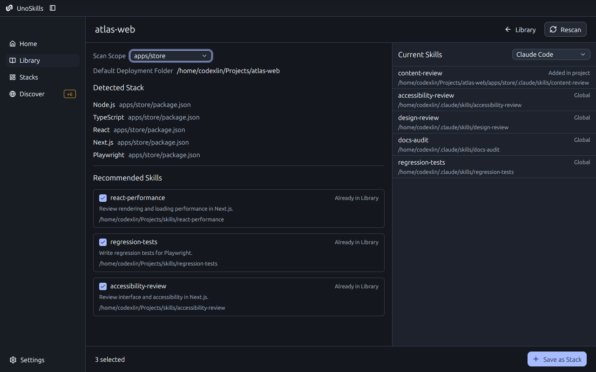
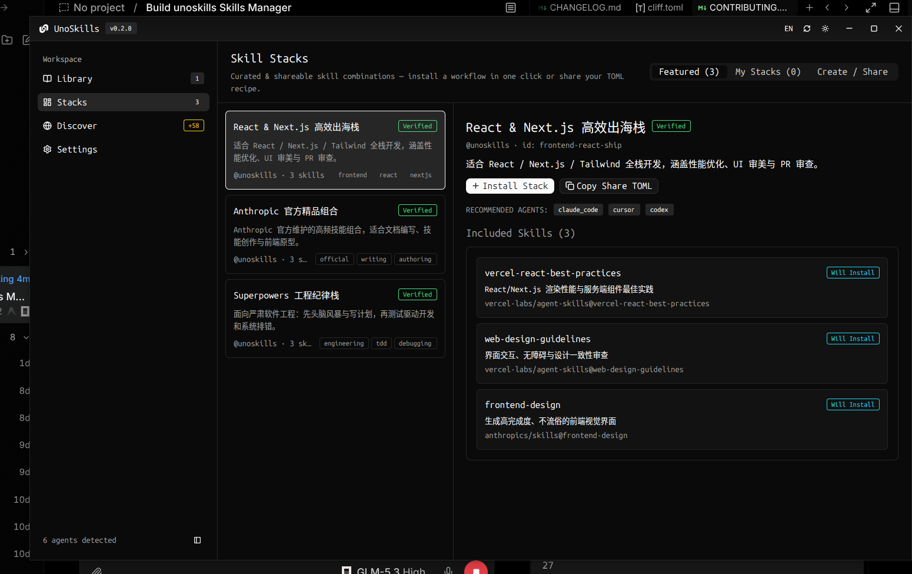
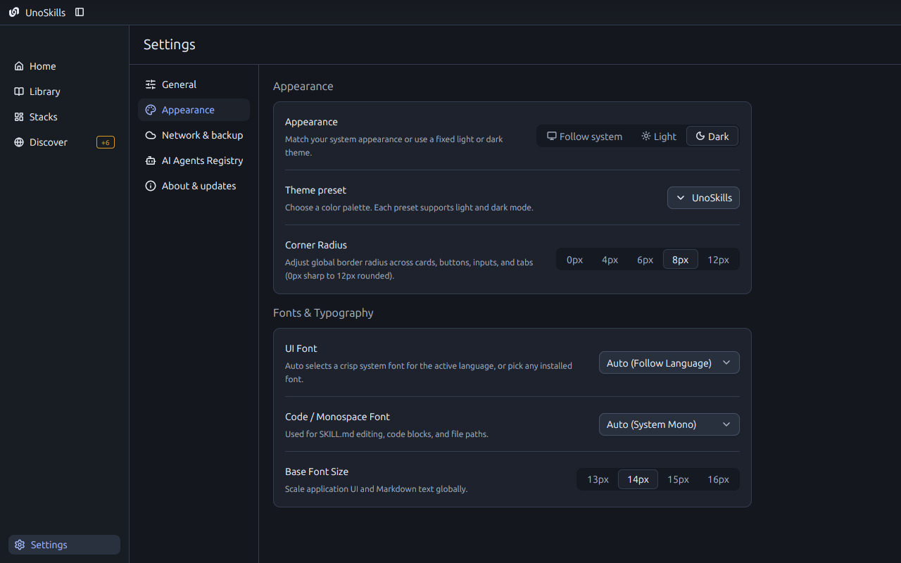

<p align="center">
  
</p>

<h1 align="center">UnoSkills</h1>

<p align="center">
  A native desktop workbench for AI agent skills.<br/>
  Keep one local library, build reusable stacks, and deploy them to the agents and projects you use.
</p>

<p align="center">
  <a href="https://github.com/codexlin/UnoSkills/releases/latest"></a>
  <a href="https://github.com/codexlin/UnoSkills/actions/workflows/ci.yml"></a>
  <a href="LICENSE"></a>
</p>

<p align="center">
  <a href="https://github.com/codexlin/UnoSkills/releases/latest"><strong>Download</strong></a> ·
  <a href="#quick-start">Quick start</a> ·
  <a href="#project-skills">Project skills</a> ·
  <a href="#desktop-screenshots">Screenshots</a> ·
  <a href="README.zh-CN.md">简体中文</a>
</p>



## Install

Download the installer for your platform from [GitHub Releases](https://github.com/codexlin/UnoSkills/releases/latest). Each release includes the desktop app, the `unoskills` CLI, and `SHA256SUMS.txt`.

| Platform | Installer |
| --- | --- |
| macOS 14 or later (Apple Silicon) | Open `unoskills-macos-arm64.dmg` and drag UnoSkills to Applications. |
| Windows x64 | Run `unoskills-setup-<version>-windows-x64.exe`. |
| Debian and Ubuntu x64 with GTK 4.14 or later | Run `sudo apt install ./unoskills_<version>_amd64.deb`. |

Portable archives, including the macOS CLI, are available on the same release page. macOS builds are currently ad-hoc signed.

### CLI

The prebuilt CLI runs on Apple Silicon with macOS 14 or later and on x86_64 Linux with glibc 2.39 or later (for example, Ubuntu 24.04). On Linux, Homebrew supplies OpenSSL 3. For the curl installer, install your distribution’s OpenSSL 3 runtime (`libssl.so.3` and `libcrypto.so.3`).

**Homebrew**

```sh
brew install codexlin/tap/unoskills
unoskills --version
```

**curl**

```sh
curl -fsSL https://github.com/codexlin/UnoSkills/releases/latest/download/install.sh -o unoskills-install.sh &&
  sh unoskills-install.sh
```

Each `install.sh` downloads and verifies the CLI using `SHA256SUMS.txt` from its own release. It installs to `~/.local/bin` without `sudo`. Set `UNOSKILLS_INSTALL_DIR` to an absolute path to use a different directory, and add that directory to your `PATH` if needed.

### Upgrading

Install the latest release over your existing UnoSkills installation. The desktop app and CLI continue to use your `~/.unoskills` library and settings. In **Settings → About & updates**, check for a release, download and verify the installer, then open it when ready.

For the CLI, run `brew update && brew upgrade unoskills` or download and run the latest `install.sh` again, depending on how you installed it.

## Quick start

1. **Add a skill.** In **Discover**, browse skills.sh or choose **Install from Link** to add a GitHub skill, an `owner/repo@skill` reference, or a local folder. **Local skills** lists skills already on your machine that you can bring under management.
2. **Deploy from your library.** Select a skill in **Library** and toggle deployment for the agents that need it.
3. **Save a reusable stack.** In **Stacks → My Stacks**, group skills into a named stack. Install its missing skills together, export the TOML, or share it with your team.

UnoSkills uses symlink mode by default. If it can’t create a directory link, it copies the skill into the deployment folder. Agents using a link see the latest library contents the next time they read the skill files. Deployed copies keep their contents when you edit a skill in the library. Applying an update or restoring the previous version in the library can refresh unchanged managed copies while preserving locally modified copies.

The library lives on your machine at `~/.unoskills`. Library management, local stacks, and TOML import and export work without an account.

## Project skills

Attach a project from **Home → Recent Projects**. Open it to see the technologies UnoSkills recognized and the configuration file behind each result. For a monorepo, choose a detected subproject under **Scan Scope** to get recommendations for that part of the codebase.



Select the skills you want and choose **Save as Stack**. If skills are missing from the library, install them and continue to the deployment preview. Choose an agent and the **Deployment Folder**. The preview defaults to the project root and also lets you choose a detected subproject. It shows the deployment counts before confirmation and preserves existing files when targets conflict.

<details>
<summary>See the deployment preview</summary>


</details>

## What you can do

| Area | What it does |
| --- | --- |
| **Home** | Check local Agent, project, and skill status, open recent work, and browse trending skills. |
| **Library** | Preview or edit `SKILL.md`, check lint findings and token estimates, preview updates, restore the previous version, and manage per-Agent deployments. |
| **Stacks** | Use featured or community stacks, create your own, and exchange portable TOML manifests. |
| **Discover** | Search the marketplace, filter loaded results by source, install from links, or add existing local skills to the library. |
| **Settings** | Choose a theme preset, search installed fonts, set the base text size, and configure language, agents, network access, and Git backup. |

## Desktop screenshots

These Linux screenshots use a sample workspace.

<details>
<summary>Library and Stacks</summary>




</details>

<details>
<summary>Discover and Settings</summary>




</details>

## Supported agents

UnoSkills detects 22 built-in agents, including Claude Code, Codex, Cursor, Antigravity, OpenCode, Gemini CLI, and GitHub Copilot. See the [full agent registry](crates/unoskills-core/data/agents.toml). You can register a custom agent or override a built-in agent’s skills directory in **Settings**.

## CLI

The desktop app and CLI share the same library and SQLite database. Use `--json` when scripting.

```bash
unoskills install anthropics/skills@skill-creator
unoskills deploy skill-creator --agent claude_code --agent codex
unoskills project add ./my-app
unoskills project deploy skill-creator --project my-app --agent codex
unoskills stack install ./frontend-review.unoskills-stack.toml
unoskills list --json
```

## Development

Use stable Rust and the system dependencies in the [CI workflow](.github/workflows/ci.yml). The Cargo build embeds the UI. Use the NSH 0.6.1 CLI to check, bundle, and test the TSX separately.

```bash
cargo test --workspace --locked
cargo run -p unoskills-app --locked
cargo run -p unoskills-cli --locked -- agents
nsh check crates/unoskills-app/ui
nsh build crates/unoskills-app/ui --release
nsh test crates/unoskills-app/ui
```

The desktop app moved from GPUI to Native Shell (NSH). The app and CLI share a Rust core for the library and safe deployment.

- [Architecture](docs/ARCHITECTURE.md)
- [Desktop design standards](DESIGN.md)
- [Skill stack format](docs/STACKS_SPEC.md)
- [Roadmap](docs/ROADMAP.md)
- [Contributing](CONTRIBUTING.md) and [engineering guidelines](AGENTS.md)

## Troubleshooting

- **macOS blocks the first launch.** Check **System Settings → Privacy & Security** for the option to allow the app to open.
- **The Linux app fails to open.** Check that GTK 4.14 or later is available. Launch `unoskills-app` from a terminal to read the startup error.
- **An agent is missing.** Check its detection or path override in **Settings**. If you [open an issue](https://github.com/codexlin/UnoSkills/issues), include the relevant portion of `unoskills agents --json`.

## License

[MIT](LICENSE)
