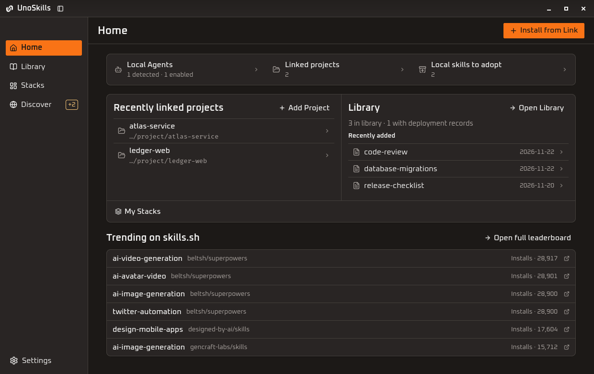
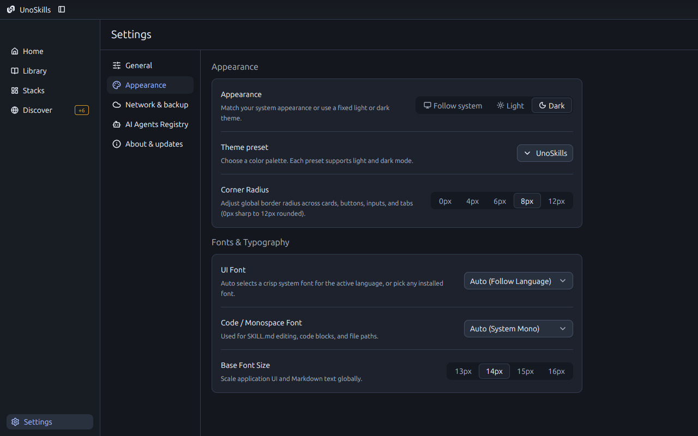

<p align="center">
  
</p>

<h1 align="center">UnoSkills</h1>

<p align="center">
  管理 AI Agent 技能的原生桌面工作台。<br/>
  用一个本地技能库积累技能，把常用技能保存成组合，再部署给所需的 Agent 和项目。
</p>

<p align="center">
  <a href="https://github.com/codexlin/UnoSkills/releases/latest"></a>
  <a href="https://github.com/codexlin/UnoSkills/actions/workflows/ci.yml"></a>
  <a href="LICENSE"></a>
</p>

<p align="center">
  <a href="https://github.com/codexlin/UnoSkills/releases/latest"><strong>下载安装</strong></a> ·
  <a href="#快速上手">快速上手</a> ·
  <a href="#项目技能">项目技能</a> ·
  <a href="#桌面截图">截图</a> ·
  <a href="README.md">English</a>
</p>



## 安装

到 [GitHub Releases](https://github.com/codexlin/UnoSkills/releases/latest) 下载对应平台的安装包。每个版本都附带桌面应用、`unoskills` CLI 和 `SHA256SUMS.txt` 校验文件。

| 平台 | 安装方式 |
| --- | --- |
| macOS 14 及以上（Apple 芯片） | 打开 `unoskills-macos-arm64.dmg`，将 UnoSkills 拖到「应用程序」。 |
| Windows x64 | 运行 `unoskills-setup-<版本>-windows-x64.exe`。 |
| Debian 和 Ubuntu x64（GTK 4.14 及以上） | 运行 `sudo apt install ./unoskills_<版本>_amd64.deb`。 |

发布页也提供便携压缩包，其中包含 macOS CLI。macOS 构建目前采用临时签名。

### 升级

在原有 UnoSkills 应用上安装最新版本。桌面端和 CLI 继续读取 `~/.unoskills` 中的技能库和设置。也可以在「设置 → 关于与更新」检查版本，下载并校验安装包，再打开安装。

## 快速上手

1. **添加技能。** 在「发现」浏览 skills.sh，也可以点「从链接安装」添加 GitHub 技能、`owner/repo@skill` 引用或本地目录。「本机技能」列出当前 Agent 已有的技能，可以统一纳入技能库管理。
2. **从技能库部署。** 选中技能，打开需要使用它的 Agent 的部署开关。软链接模式让 Agent 使用中央库中的同一份技能。复制模式会在部署目录保存一份副本。
3. **保存常用组合。** 在「技能组合 → 我的组合」中，给一组常用技能起个名字。可以一次安装组合中缺少的技能，也可以导出 TOML 与团队分享。

技能库默认位于本机的 `~/.unoskills`。管理本地技能、使用个人组合、导入和导出 TOML 均无需登录。

## 项目技能

在「首页」的「最近关联项目」区域点击「添加项目」。打开项目后，可以查看识别到的技术栈及其配置文件。对于包含多个子项目的仓库，可以通过「识别范围」切换到具体子项目，查看对应的技能推荐。


选好技能后点击「保存为组合」。如果有技能尚未入库，可以连续完成安装和部署预览。预览默认选择项目根目录，也可以改为识别到的子项目。确认前会显示部署状态，遇到同名冲突会保留原有文件。

<details>
<summary>查看部署预览截图</summary>


</details>

## 功能一览

| 页面 | 可以做什么 |
| --- | --- |
| **首页** | 查看本机 Agent、项目和技能状态，打开最近项目或技能，浏览热门技能。 |
| **技能库** | 预览或编辑 `SKILL.md`，查看检查结果和 token 估算，预览技能更新、恢复上一版本并管理各 Agent 的部署。 |
| **技能组合** | 使用精选或社区组合，保存个人组合，导入和导出可分享的 TOML 清单。 |
| **发现** | 搜索市场、按来源筛选已加载结果、从链接安装，或将本机技能纳入技能库。 |
| **设置** | 选择主题预设、搜索已安装字体、调整基础字号，设置语言、Agent、网络和 Git 备份。 |

## 桌面截图

截图来自 Linux 构建，使用示例工作区和英文界面。

<details>
<summary>技能库和技能组合</summary>


</details>

<details>
<summary>发现和设置</summary>




</details>

## 支持的 Agent

自动检测 22 个内置 Agent，包括 Claude Code、Codex、Cursor、Antigravity、OpenCode、Gemini CLI 和 GitHub Copilot。完整名单见 [Agent 注册表](crates/unoskills-core/data/agents.toml)。也可以在「设置」注册自定义 Agent，或覆盖内置 Agent 的技能目录。

## CLI

桌面应用和 CLI 共用技能库及 SQLite 数据库。脚本可加 `--json` 获取结构化输出。

```bash
unoskills install anthropics/skills@skill-creator
unoskills deploy skill-creator --agent claude_code --agent codex
unoskills project add ./my-app
unoskills project deploy skill-creator --project my-app --agent codex
unoskills stack install ./frontend-review.unoskills-stack.toml
unoskills list --json
```

## 开发

使用稳定版 Rust 工具链和 [CI 工作流](.github/workflows/ci.yml) 中的系统依赖。Cargo 构建会内嵌桌面 UI。使用 NSH 0.6.1 CLI 可以单独检查、构建和测试 TSX。

```bash
cargo test --workspace --locked
cargo run -p unoskills-app --locked
cargo run -p unoskills-cli --locked -- agents
nsh check crates/unoskills-app/ui
nsh build crates/unoskills-app/ui --release
nsh test crates/unoskills-app/ui
```

桌面端基于 Native Shell（NSH），技能库和部署逻辑由 Rust 核心实现，桌面端与 CLI 共用同一套核心逻辑。

- [架构](docs/ARCHITECTURE.md)
- [技能组合格式](docs/STACKS_SPEC.md)
- [路线图](docs/ROADMAP.md)
- [贡献指南](CONTRIBUTING.md)及[工程规范](AGENTS.md)

## 疑难解答

- **macOS 拦截首次打开。** 在「系统设置 → 隐私与安全性」中查看允许打开应用的选项。
- **Linux 应用无法打开。** 确认系统提供 GTK 4.14 或更高版本，可从终端运行 `unoskills-app` 查看启动错误。
- **没有检测到某个 Agent。** 先在「设置」检查检测状态和路径配置。如果需要[提交问题](https://github.com/codexlin/UnoSkills/issues)，请附上 `unoskills agents --json` 中与问题相关的部分。

## 许可证

[MIT](LICENSE)
