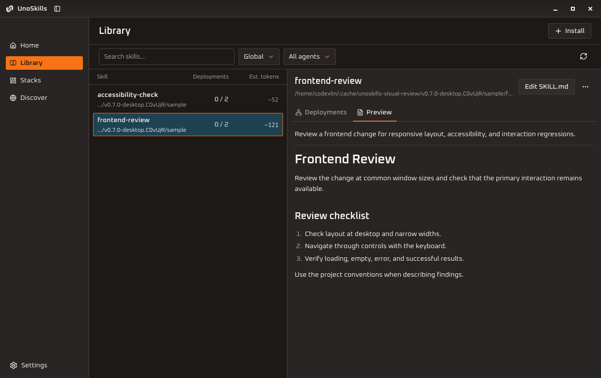
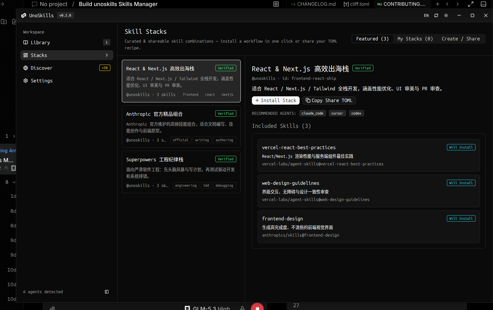
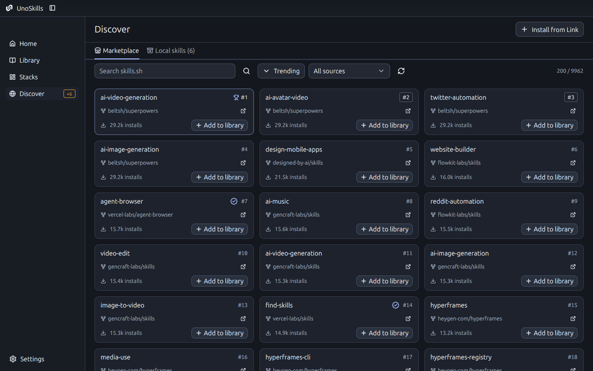

<p align="center">
  
</p>

<h1 align="center">UnoSkills</h1>

<p align="center">
  一个<strong>快速、原生 Rust</strong> 的 AI 技能工作台<br/>跨所有编程工具管理、分享、同步 Agent 技能与<strong>技能组合</strong>
</p>

<p align="center">
  纯 Rust · 零 WebView · 零 Node.js · 秒级启动
</p>

<p align="center">
  <a href="https://github.com/codexlin/UnoSkills/actions/workflows/ci.yml"></a>
  <a href="https://github.com/codexlin/UnoSkills/releases/latest"></a>
  <a href="LICENSE"></a>
  
  
</p>

<p align="center">
  <a href="README.md">English</a>
  &nbsp;·&nbsp;
  <a href="#特性">特性</a> &nbsp;·&nbsp;
  <a href="#安装">安装</a> &nbsp;·&nbsp;
  <a href="#快速上手">快速上手</a> &nbsp;·&nbsp;
  <a href="#支持的编程工具">支持的编程工具</a> &nbsp;·&nbsp;
  <a href="#开发">开发</a>
</p>

---

<p align="center">
  
</p>
<p align="center"><em><strong>Library 技能库</strong> — 查看技能、检查 Lint 与上下文 token 预算、一键切换各 Agent 的部署状态。</em></p>

## 为什么是 UnoSkills？

市面上的技能管理器大多是 Electron/Tauri 套壳 WebView 加 Node 运行时。UnoSkills 基于 [GPUI Kit](https://gpui-kit.com/zh-CN/docs/)（[Zed](https://zed.dev) 背后的 GPU 渲染器）构建——整个应用（列表、Markdown 预览、对话框）都直接在 GPU 上原生渲染，启动是瞬时的、内存占用极低，并且长列表全部走虚拟化，技能再多也依然丝滑。

但"快"只是一半。技能管理器要直接碰你各个 Agent 的配置目录，所以**安全是产品能力，不是免责声明**：

- **严格技能识别** — 只认 `SKILL.md`（及旧版 `skill.md`），绝不会把 `README.md` 或 `CLAUDE.md` 误判成技能。
- **绝不静默覆盖** — 目标分类使用 `symlink_metadata`（不跟随链接），部署默认 `NoClobber`：遇到未纳管的目录会弹确认对话框，而不是悄悄覆盖你的文件。
- **共享目录引用计数** — 多个 Agent 解析到同一物理目录（如 `~/.agents/skills`）时，取消部署其中一个 Agent 绝不会误删另一个 Agent 正在使用的技能。
- **路径加固** — 每个目录 slug 都经过穿越/保留名消毒；每次复制/链接都做源目标重叠检查，杜绝无限递归。
- **破坏性操作必须确认** — CLI 的 `remove` 强制 `--yes`；GUI 一律显式 `AlertDialog` 确认。

## 特性

<p align="center">
  
</p>
<p align="center"><em><strong>Stacks 技能组合</strong> — 一键安装整套精选技能组合，也能打包你自己的组合。</em></p>

### 📚 Library — 中央技能库

- 从 Git 仓库（`owner/repo@skill`）、GitHub `/tree/branch/subpath` 链接、本地目录或 [skills.sh](https://skills.sh) 市场安装技能——全部收进一个本地优先的中央库（默认 `~/.unoskills`，无需登录）。
- 原地预览并快速编辑 `SKILL.md`；每个技能自带 Frontmatter Lint 和上下文 token 估算。
- **一键检查更新**：通过 SHA-256 对比 Git / `skills.sh` / 本地来源，原地升级且不破坏符号链接与已纳管部署。
- 技能卡片上就是**逐 Agent 部署开关**——Symlink（默认，随中央库实时更新）或 Copy 两种模式，覆盖 22 个内置 Agent 与你注册的任何自定义工具。
- **项目级作用域**：绑定一个代码仓库工作区，把技能部署进项目内的 `.claude/skills`、`.codex/skills`、`.cursor/skills`……安全保证与全局部署完全一致。

### 🧩 Stacks — 技能组合

- 一个 Stack 就是一份声明式 `.unoskills-stack.toml` 清单——用名字打包一组技能配方，**不复制任何技能源码**。
- 内置精选组合（React & Next.js 高效出海栈、Anthropic 官方精品组合、Superpowers 工程纪律栈……）；也可以从已装技能创建自己的组合，导出 TOML 通过 Gist 或 PR 分享。
- **增量一键安装**：已存在的技能自动跳过、缺失的自动拉取，绝不重复安装。

### 🔍 Discover — 发现与收编

<p align="center">
  
</p>
<p align="center"><em><strong>收编</strong> — 手动装过的技能会被自动扫描出来，一键纳入中央库管理。</em></p>

- 快速安装：`owner/repo@skill`、GitHub 链接或本地目录。
- 浏览 [skills.sh](https://skills.sh) 排行榜（热门趋势 / 飙升榜 / 总榜），支持关键词搜索与无限滚动。
- **收编已有技能**：扫描各 Agent 目录里的未纳管技能并纳入管理——无需重装、不会重复。

### ⚙️ Settings — 设置

- 完整的**简体中文 / English / 日本語**界面，深/浅色主题，系统字体自动发现（对 CJK 字体友好）。
- 默认部署模式（Symlink/Copy）、代理支持（HTTP/SOCKS，覆盖 Git 与市场请求）、仅存本地的 GitHub PAT，以及**声明式 Agent 注册表**——22 个 Agent 全部定义在一个 `agents.toml` 里，自动检测安装状态。

### 🖥️ 随应用附带对 Agent 友好的 CLI

`unoskills` CLI 与桌面应用共享同一套引擎和 SQLite 数据库——而且每条命令都支持 `--json`，让 Claude Code / Codex / 你的脚本能自己管理技能：

```bash
unoskills install anthropics/skills@skill-creator
unoskills deploy skill-creator --agent claude_code --agent codex
unoskills stack install rust-gpui-workbench --agent cursor
unoskills update skill-creator
unoskills adopt --dry-run          # 先看看有哪些未纳管技能
unoskills project deploy my-skill --project my-app --agent opencode
unoskills list --json              # 机器可读输出
```

## 安装

从 [**Releases**](https://github.com/codexlin/UnoSkills/releases/latest) 下载最新版——每个版本都附带 `SHA256SUMS.txt` 校验文件：

| 平台 | 推荐下载 | 说明 |
|---|---|---|
| macOS (Apple Silicon) | `unoskills-macos-arm64.dmg` | 把 `UnoSkills.app` 拖进 `/Applications` |
| Windows x64 | `unoskills-setup-<版本>-windows-x64.exe` | Inno Setup 安装器：开始菜单 + 卸载支持 |
| Linux (Debian/Ubuntu) | `unoskills_<版本>_amd64.deb` | `sudo apt install ./unoskills_<版本>_amd64.deb` |

裸二进制（`unoskills-app-*` 桌面端、`unoskills-*` CLI）和原始压缩包也在附件里，供进阶用户使用。

> **提示（macOS）**：当前构建尚未做 Developer ID 签名/公证，首次打开需要 右键 → **打开**。正式签名已在[路线图](docs/ROADMAP.md)中。

## 快速上手

1. **装一个技能** — 打开 **Discover**，粘贴 `owner/repo@skill` 或 GitHub 链接、选本地目录，或从市场挑一个。
2. **部署它** — 在 **Library** 里翻开对应 Agent 的开关。Symlink 模式下部署出去的技能会随中央库实时更新。
3. **打包一个工作流** — 在 **Stacks** 里选中若干技能 → **新建**，导出 TOML 即可分享给团队。
4. **收编旧技能** — 以前手动装过的技能？**Discover → 收编已有技能** 直接吸收，无需重装。
5. 可选：在 Library 顶栏绑定**项目工作区**，让每个仓库的技能彼此隔离。

## 分享技能组合

每个 Stack 都是一份轻量的声明式 TOML 清单——不复制任何技能源码：

```toml
[stack]
id = "rust-gpui-workbench"
name = "Rust + GPUI Native Stack"
author = "your-github-handle"
description = "Curated skills for building native Rust desktop apps."
tags = ["rust", "gpui", "desktop"]
recommended_agents = ["claude_code", "codex", "cursor"]

[[stack.skills]]
name = "skill-creator"
source = "anthropics/skills@skill-creator"
note = "Author and lint SKILL.md files"
```

从 URL、本地文件或应用内直接安装：`unoskills stack install rust-gpui-workbench --agent claude_code`。

## 支持的编程工具

内置支持 22 个 Agent，全部自动检测：

Claude Code · Codex · Cursor · Antigravity · OpenCode · Gemini CLI · GitHub Copilot · Windsurf · Cline · Roo Code · Kilo Code · Amp · Goose · TRAE IDE · Warp · Kimi Code CLI · Grok · Droid · Augment · Replit · OpenClaw · OMP Agent

**设置**里还能注册带自定义技能目录的工具，或覆盖内置 Agent 的默认路径。

## 技术栈

| 层 | 技术 |
|---|---|
| UI | [GPUI Kit](https://gpui-kit.com/zh-CN/docs/)（GPUI — Zed 的 GPU 渲染器） |
| 领域内核 | 纯 Rust、SQLite WAL、Symlink/Copy/Junction 同步引擎 |
| CLI | `clap`、`--json` 机器可读输出 |
| i18n | 简体中文 / English / 日本語 |
| 打包 | `.dmg`（App Bundle）· Inno Setup `.exe` · `.deb` |

## 开发

**环境要求**：Rust 1.85+（edition 2024）。Linux 上需先安装 GPUI 系统依赖（具体包列表见 `ci.yml`）。

```bash
cargo test -p unoskills-core          # 内核单元与集成测试
cargo run -p unoskills-app             # 原生 GPUI 桌面应用
cargo run -p unoskills-cli -- agents   # CLI
```

工作区结构：

```text
unoskills/
├── crates/
│   ├── unoskills-core/   # 纯 Rust 领域层：SQLite WAL、安全同步、技能组合、data/*.toml
│   ├── unoskills-cli/    # 轻量 `unoskills` CLI（--json）
│   └── unoskills-app/    # GPUI Kit 应用（shell、features/*、i18n、assets）
├── docs/                 # 架构、Stack 规范、路线图
├── packaging/            # 各平台安装包模板与图标
└── skills/unoskills/    # 内置的自举 SKILL.md
```

## 文档

- **[架构与最佳实践](docs/ARCHITECTURE.md)** — 工作区边界、GPUI 实体/事件流、性能与同步安全模式
- **[技能组合规范](docs/STACKS_SPEC.md)** — 声明式 `.unoskills-stack.toml` 格式与社区演进
- **[路线图](docs/ROADMAP.md)** — 已交付能力与后续里程碑
- **[AGENTS.md](AGENTS.md)** — 面向 AI Agent 与贡献者的强制工程规范
- **[CONTRIBUTING.md](CONTRIBUTING.md)** — 如何新增 Agent、语言或精选组合

## 疑难解答

**macOS 首次打开被拦截。** 当前构建未签名，Gatekeeper 会提示"无法验证开发者"。右键 `UnoSkills.app` → **打开** → 确认即可。（Developer ID 签名 + 公证已在计划中。）

**Linux：窗口打不开 / 白屏。** GPUI 走 Vulkan（wgpu）渲染，精简虚拟机请安装 Vulkan 驱动（如 `mesa-vulkan-drivers`）；纯 Wayland 合成器需 XWayland 支持，X11 后端依赖 `libxkbcommon-x11`。

其他问题 — [提个 issue](https://github.com/codexlin/UnoSkills/issues)，附上 `unoskills agents --json` 的输出。

## 许可证

MIT
